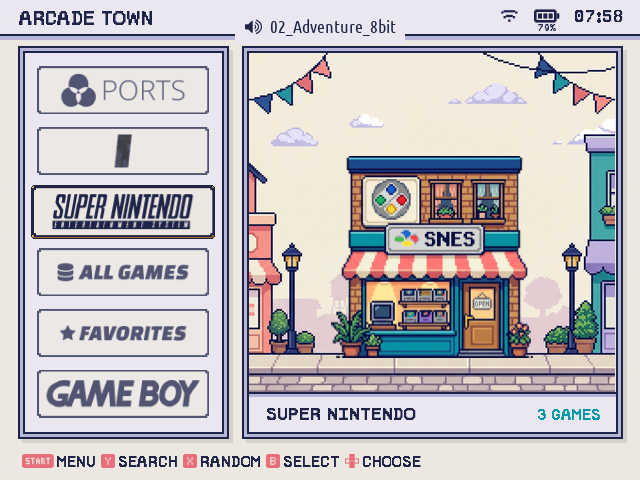
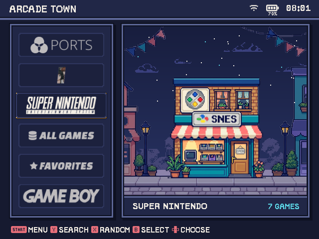
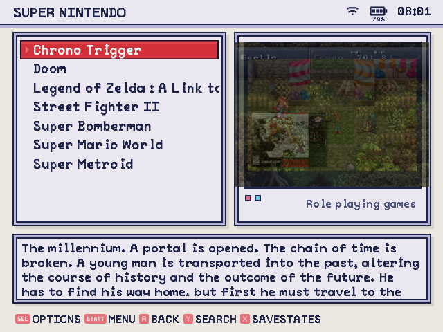

# es-theme-arcade-town

A cozy 16-bit pixel-art RPG town frontend theme for **ArkOS / EmulationStation-fcamod**, designed natively for **640×480 (4:3)** handhelds such as the **R36S**.

## Screenshots

| System View (Daylight Cream) | System View (Midnight Arcade) |
| :---: | :---: |
|  |  |

| Gamelist View (Detailed) |
| :---: |
|  |

## Features

- **Custom Pixel-Art Town Shops:** Dedicated storefronts for `snes` / `sfc`, `nes` / `famicom` / `fds`, `gb`, `gbc`, `gba`, `nds`, `n64`, `psx`, `ports`, plus a cozy `default.png` arcade shop fallback.
- **Day & Night Color Schemes:** Switch between **Daylight Cream** and **Midnight Arcade (Dark)** under **Start → UI Settings → Theme Configuration**.
- **2 Left-Pane List Styles:**
  - **Boxed Logo Carousel** *(default)* — 6-slot vertical carousel with pre-rendered system boxes and a gold-trimmed RPG selector frame.
  - **Classic RPG Menu List** — Clean text-only menu list matching the gamelist view.
- **Retro Typography & UI:** **Peaberry Base** pixel font, warm cream/navy/gold/coral palette, custom 16-bit RPG UI sound effects (`_inc/sounds/`), and 8-bit chiptune BGM (`_inc/music/02_Adventure_8bit.ogg`).
- **Splash & Boot Logo:** Matching EmulationStation loading splash (`<view name="splash">`) and optional ArkOS boot logo (`extras/arkos-boot/logo.bmp`).

## Compatibility

- **Resolution:** 640×480 (4:3)
- **Tested on:** R36S running **ArkOS** (`EmulationStation-fcamod` v2.13.0.0) and **Batocera EmulationStation**

## Clean Installation (ArkOS / R36S)

### Option 1: Download & Copy to SD Card (First-Time Install)
1. Download the repository ZIP (or latest release) and extract it on your computer.
2. Insert your ArkOS SD card and open the `EASYROMS` partition.
3. Create the folder `EASYROMS/themes/es-theme-arcade-town/` *(if updating from an older version, delete the old folder first for a clean install)*.
4. Copy these **required** files and folders from the extracted repo into `EASYROMS/themes/es-theme-arcade-town/`:
   - `theme.xml`
   - `systems/`
   - `_inc/`
   - `art/`
   *(You do **not** need to copy `screenshots/`, `extras/`, `README.md`, `LICENSE`, `ART_STYLE_PROMPTS.md`, or `run_es_preview.sh` to `themes/`.)*
5. *(Optional — ArkOS Boot Logo)* Open the `BOOT` partition, back up the existing `BOOT/logo.bmp` (e.g. rename it to `logo.bmp.bak`), then copy `extras/arkos-boot/logo.bmp` to `BOOT/logo.bmp`.
6. Safely eject the SD card, boot your handheld, and select **es-theme-arcade-town** under **Start → UI Settings → Theme Set** (press **B** / **A** to apply, then restart EmulationStation if prompted).

### Option 2: Git Clone on Device (via SSH / Terminal)
```bash
rm -rf /roms/themes/es-theme-arcade-town
git clone https://github.com/actuallyraihan/es-theme-arcade-town-fcamod.git /roms/themes/es-theme-arcade-town
```
Then select **es-theme-arcade-town** under **Start → UI Settings → Theme Set**.

## Theme Configuration

Open **Start → UI Settings → Theme Configuration**:
- **Color Scheme:** `Daylight Cream` *(default)* | `Midnight Arcade (Dark)`
- **Left Console List Style:** `Boxed Logo Carousel` *(default)* | `Classic RPG Menu List`

## Local Preview & Contributing

To preview the theme locally on Linux using EmulationStation:

```bash
./run_es_preview.sh
```

You can also point `ES_BIN` to a custom EmulationStation binary:

```bash
ES_BIN=/path/to/emulationstation ./run_es_preview.sh
```

See [ART_STYLE_PROMPTS.md](ART_STYLE_PROMPTS.md) for the pixel-art style guide and prompts used to create shop storefronts.

## Credits

- **Typography:** Peaberry Base (`_inc/fonts/PeaberryBase.ttf`)
- **Background Music:** `02_Adventure_8bit.ogg` (CC0 8-bit chiptune)
- **System Logos & Icons:** Standard EmulationStation SVG logos and custom pixel-grid UI icons

## License

Released under the [MIT License](LICENSE).
